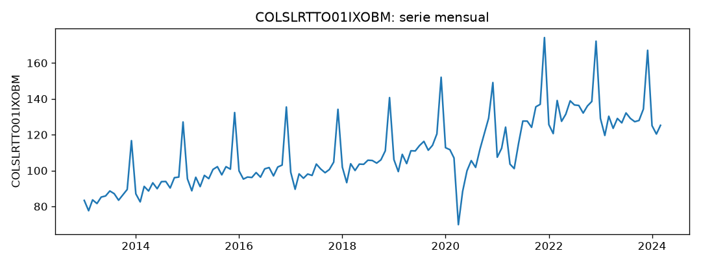
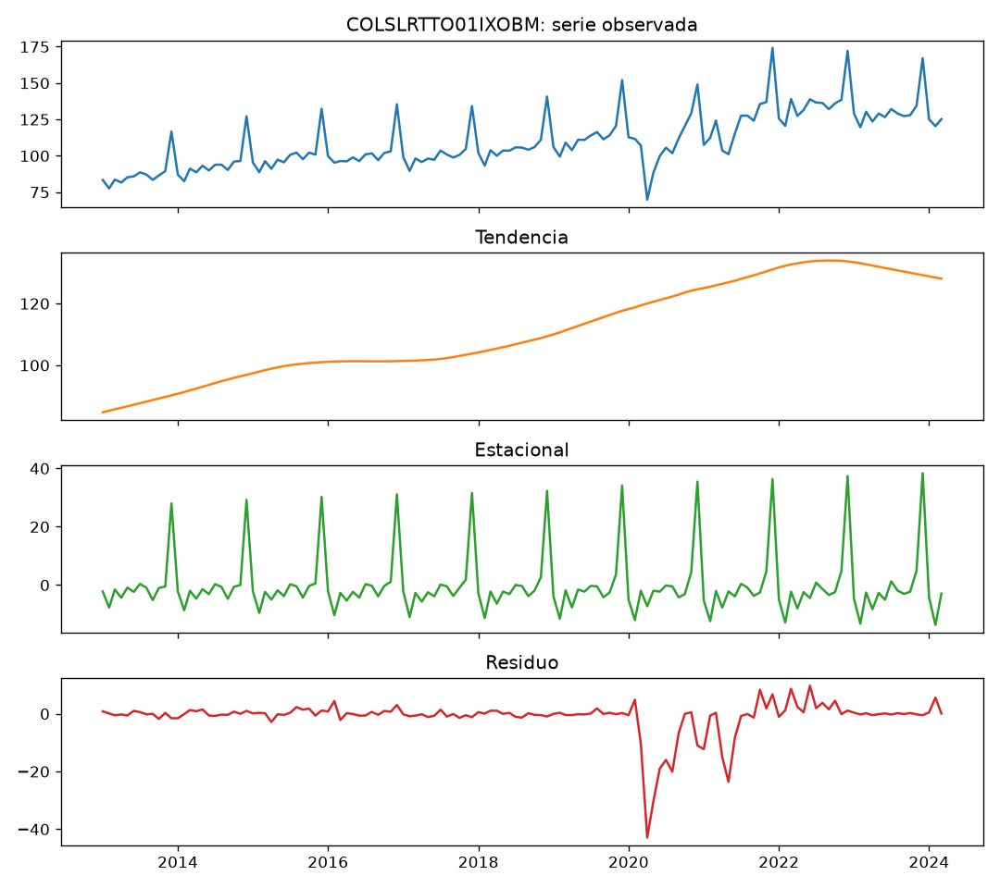
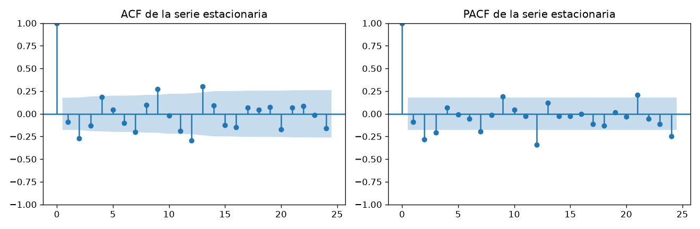
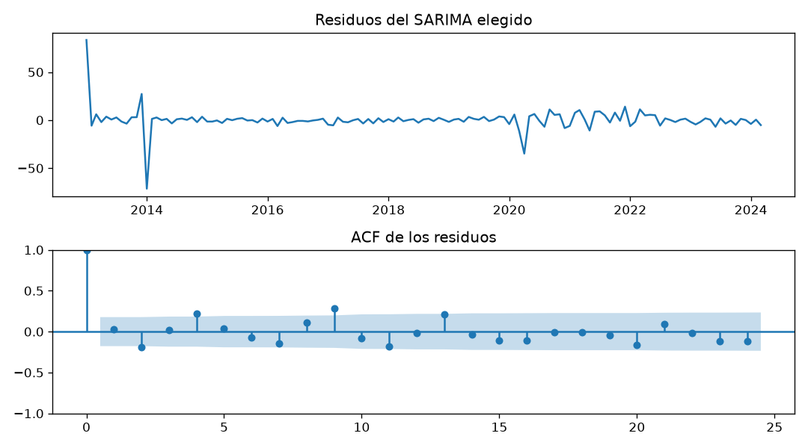

# Informe del miniproyecto 1

## 1. La serie

La serie mide el **índice de volumen del comercio minorista de Colombia**, base
$2015 = 100$, sin desestacionalizar. Sale de la OCDE (*Main Economic
Indicators*) vía FRED
(`COLSLRTTO01IXOBM`), es pública y de uso libre con cita a la fuente. Es
mensual y va de **2013-01 a 2024-03**: 135 observaciones.

La elegí porque cumple los tres mínimos del enunciado a la vez:

- es **mensual** y pública, con fuente y licencia citables;
- tiene **135 observaciones** (más de los cinco años pedidos), con margen para
  el *backtest* de 24 meses;
- su **estacionalidad es muy visible**: el comercio minorista sube fuerte en
  diciembre y baja en febrero, así que la diferencia estacional y el SARIMA
  tienen algo real que modelar.

**Huecos y datos atípicos.** La fuente trae los 135 meses completos: no hay
huecos. Los únicos valores que sobresalen de la media global (índice por encima
de 160 en diciembre de 2021 a 2023, con $|z| > 3$) son el **pico estacional de
fin de año**, no errores de medición. Decidí **no reemplazarlos ni
recortarlos**: quitar el pico de diciembre destruiría justo la estacionalidad
que el modelo debe aprender. En `preparar()` se deja una interpolación lineal
solo como respaldo por si la fuente llegara a traer un mes vacío; hoy no toca
ningún valor. Esta decisión es la columna `decision` de la tabla de métricas.

## 2. Componentes

Se descompuso la serie con una **STL robusta** de periodo 12:

$$y_t = T_t + S_t + R_t,$$

donde $T_t$ es la tendencia, $S_t$ la componente estacional y $R_t$ el
residuo. La versión robusta baja el peso de los meses extremos, así que el
residuo de abril de 2020 (el confinamiento) no deforma la tendencia.

La lectura con las cifras de la serie:

- **Tendencia creciente**: va de $84.7$ a $128.1$ puntos del índice entre 2013
  y 2024. El crecimiento es real (las ventas minoristas crecieron), con una
  caída visible en 2020 que después se recupera.
- **Estacional**: el mes más alto es **diciembre, con $+33.1$** puntos sobre la
  tendencia, y el más bajo **febrero, con $-11.2$**. La diferencia
  diciembre–febrero es de unos $44$ puntos, una estacionalidad fuerte.
- **Residuo más grande**: **abril de 2020, con $-42.9$**. Es el cierre de la
  economía por la pandemia: las ventas cayeron muy por debajo de lo que
  tendencia y estacional predecían. El STL robusto lo deja íntegro en el
  residuo en lugar de repartirlo por la tendencia.

## 3. Líneas base y backtest

El *backtest* común usa **origen móvil sobre los últimos 24 meses** y horizonte
de 1 a 12. Con 135 observaciones quedan **13 orígenes**: en cada uno se entrena
solo con los datos hasta el origen y se pronostican los 12 meses siguientes,
desde 2022-04 hasta 2024-03. Ningún dato posterior al origen entra al modelo:
cada `modelo(entrenamiento, h)` recibe únicamente `entrenamiento`, y las
métricas se promedian sobre los orígenes.

Las métricas, con $y$ el valor real y $\hat{y}$ el pronóstico, son:

$$\mathrm{RMSE} = \sqrt{\tfrac1n\sum (y-\hat y)^2}, \qquad
\mathrm{MAE} = \tfrac1n\sum |y-\hat y|, \qquad
\mathrm{MAPE} = \tfrac{100}{n}\sum \left|\tfrac{y-\hat y}{y}\right|.$$

Las dos líneas base:

- **Ingenuo**: repite el último valor observado durante los 12 meses.
- **Estacional ingenuo**: repite, para cada mes, el valor del mismo mes del año
  anterior.

| Modelo | RMSE | MAE | MAPE (%) |
|---|---|---|---|
| Ingenuo | 15.57 | 11.62 | 8.52 |
| **Estacional ingenuo** | **7.33** | **5.80** | **4.41** |

Gana el **estacional ingenuo** en las tres métricas, con bastante margen: la
memoria estacional es lo que más pesa en esta serie.

## 4. Estacionariedad e identificación

La prueba ADF tiene como hipótesis nula $H_0$: la serie tiene raíz unitaria (no
es estacionaria). Se corrió sobre las cuatro versiones, con el término
determinista adecuado a cada una (`ct` cuando todavía hay tendencia, `c` cuando
solo queda nivel):

| Versión | Regression | valor p |
|---|---|---|
| Serie | `ct` | 0.4597 |
| Diferencia regular ($d=1$) | `c` | 0.0026 |
| Diferencia estacional ($D=1$) | `ct` | 0.1815 |
| Ambas ($d=1$, $D=1$) | `c` | 0.0144 |

La serie original no es estacionaria ($p = 0.46$, no se rechaza $H_0$). La
diferencia regular elimina la tendencia y deja un nivel estacionario
($p = 0.003$), pero conserva la estacionalidad; la diferencia estacional sola
deja todavía tendencia ($p = 0.18$). Con las dos juntas la serie es estacionaria
($p = 0.014$). Por eso se eligen **$d = 1$ y $D = 1$**.

Sobre la serie ya diferenciada ($d = D = 1$, 122 meses) la banda de confianza es
$\pm 1.96/\sqrt{122} \approx \pm 0.177$. Salen de la banda:

- **ACF**: el rezago 2 ($-0.27$) y el rezago 12 ($-0.29$), con otros cortos
  (4, 7, 9, 13) rozándola;
- **PACF**: el rezago 2 ($-0.29$) y el rezago 12 ($-0.39$), más el 24.

No hay un corte limpio en ningún lado: la firma es **mixta** en los rezagos
cortos (sugiere $p, q \le 1$ en la parte regular) y aparece el **rezago 12**,
que un ARMA corto no alcanza y que exige la parte estacional $(P, Q)$ del
SARIMA.

## 5. Modelos clásicos

**Rejilla por AIC.** Con $d = D = 1$ fijos, se probaron los 16 órdenes con
$p, q, P, Q \in \{0, 1\}$ y se ordenaron por AIC:

| p | q | P | Q | AIC |
|---|---|---|---|---|
| **1** | **1** | **1** | **1** | **767.5** |
| 1 | 1 | 0 | 1 | 771.6 |
| 0 | 1 | 1 | 1 | 775.0 |
| 0 | 0 | 1 | 1 | 775.8 |
| 1 | 0 | 1 | 1 | 776.8 |
| 0 | 0 | 0 | 1 | 779.3 |
| 0 | 1 | 0 | 1 | 779.6 |
| 1 | 0 | 0 | 1 | 780.8 |
| 1 | 1 | 1 | 0 | 787.2 |
| 1 | 1 | 0 | 0 | 794.5 |
| 0 | 0 | 1 | 0 | 795.3 |
| 0 | 1 | 1 | 0 | 795.7 |
| 1 | 0 | 1 | 0 | 796.7 |
| 0 | 1 | 0 | 0 | 803.5 |
| 0 | 0 | 0 | 0 | 804.0 |
| 1 | 0 | 0 | 0 | 805.0 |

Gana el **$\text{SARIMA}(1,1,1)(1,1,1)_{12}$** con AIC 767.5. Su ecuación, con
$w_t$ la serie tras las dos diferencias, es:

$$(1 - \phi_1 B)(1 - \Phi_1 B^{12})\, w_t =
(1 + \theta_1 B)(1 + \Theta_1 B^{12})\, \varepsilon_t.$$

**Diagnóstico de residuos.** Ljung-Box pone a prueba $H_0$: los residuos son
ruido blanco (todas sus autocorrelaciones hasta el rezago $m$ son cero).

| Lags | $Q$ | valor p |
|---|---|---|
| 12 | 32.86 | 0.001 |
| 24 | 52.44 | 0.001 |

Con $p \ll 0.05$ se **rechaza** $H_0$: queda estructura en los residuos. La
gráfica y su ACF muestran que el modelo no absorbe los meses extremos —sobre
todo abril de 2020—: el residuo tiene un desvío enorme en ese punto y la
distribución queda dominada por él (curtosis alta). Es la limitación esperable
de un SARIMA lineal sobre una serie con un choque tan grande.

**La variable exógena.** Se usó el **número de festivos de cada mes en
Colombia**, que se conoce de antemano porque el calendario de festivos es fijo.
El SARIMAX agrega

$$y_t = \beta\, x_t + \eta_t, \qquad \eta_t \sim \text{SARIMA}(1,1,1)(1,1,1)_{12}.$$

El coeficiente es $\beta = -0.88$ con valor p $0.35$: **no es significativo**, y
por eso la exógena casi no aporta. En el *backtest* el SARIMAX baja apenas
frente al SARIMA: RMSE $9.47$ vs $9.58$ y MAE $8.58$ vs $8.70$. Un mes de más
festivos no cambia de forma confiable el volumen minorista, así que la mejora es
ruido más que señal. La exógena no tiene fuga: para ajustar usa
`x.loc[entrenamiento.index]` (meses ya vistos) y para pronosticar
`x.loc[fechas_siguientes(...)]` (meses futuros cuyo festivo ya se conoce).

## 6. Tabla de métricas

`resultados/metricas.csv`, ordenada por RMSE:

| Modelo | Decisión | RMSE | MAE | MAPE (%) |
|---|---|---|---|---|
| estacional ingenuo | Sin huecos (interpolación lineal de respaldo); atípicos estacionales de diciembre conservados | 7.33 | 5.80 | 4.41 |
| SARIMAX(1,1,1)(1,1,1,12) + exógenas | Sin huecos (interpolación lineal de respaldo); atípicos estacionales de diciembre conservados | 9.47 | 8.58 | 6.56 |
| SARIMA(1,1,1)(1,1,1,12) | Sin huecos (interpolación lineal de respaldo); atípicos estacionales de diciembre conservados | 9.58 | 8.70 | 6.65 |
| ingenuo | Sin huecos (interpolación lineal de respaldo); atípicos estacionales de diciembre conservados | 15.57 | 11.62 | 8.52 |

## 7. Conclusión

El mejor modelo clásico de la tabla es el **estacional ingenuo**, con
RMSE $7.33$, MAE $5.80$ y MAPE $4.41\%$. Ninguno de los SARIMA lo mejora: el
SARIMAX con festivos, el mejor de los dos, queda **29 % peor en RMSE, 48 % peor
en MAE y 49 % peor en MAPE** que la mejor línea base.

La explicación es la propia descomposición: esta serie tiene una estacionalidad
muy fuerte y muy estable (diciembre $+33$, febrero $-11$) y una tendencia
suave. Repetir el mismo mes del año anterior captura casi todo; el SARIMA suma
parámetros para modelar una memoria fina que no le alcanza a compensar su error
en los meses de choque (el residuo de abril 2020 sigue sin explicarse, como
mostró Ljung-Box). Es un resultado esperable y defendible: un SARIMA que no gana,
bien analizado, vale más que uno que gana sin explicación.

El modelo que el **miniproyecto 2 deberá superar** es el estacional ingenuo, con
RMSE $7.33$ en el *backtest* común.
